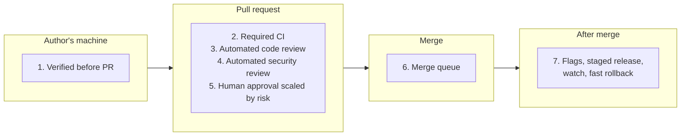
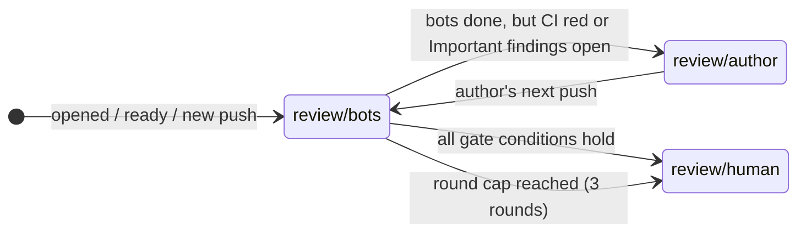
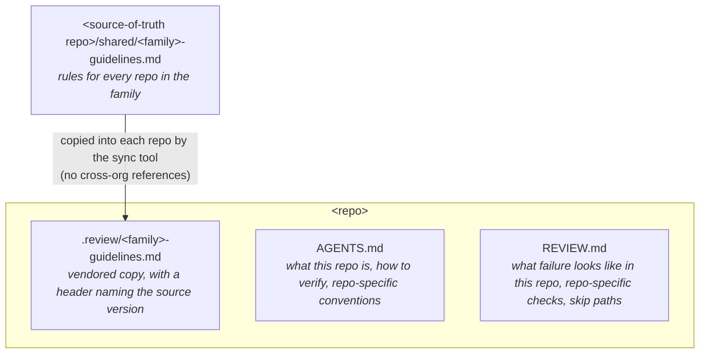

# Code Review Improvement Plan

**Scope:** generic and team-neutral. Team- and repo-specific material lives in [`teams/`](teams/) and [`pilot/`](pilot/). \
**Source inspiration:** "How the Claude Code team does code review" (claude.dev blog, Oct 2026) \
**Companion files:**
- [`01-steps.md`](01-steps.md) — phased step list with exit criteria
- [`02-team-adoption.md`](02-team-adoption.md) — questions each adopting team answers in its profile
- [`03-process-tracker.md`](03-process-tracker.md) — shared investigations, implementation progress and decisions
- [`04-templates.md`](04-templates.md) — starter templates we can create right away
- [`teams/`](teams/) — team profiles (structure, pain points, team-specific practices)
- [`pilot/`](pilot/) — per-repo pilot material
- [`shared/`](shared/) — guidance shared by a family of repos

> Scope note: this plan deliberately ignores model selection, vendor choice and paid services for now. The goal of this round is to describe the **process and the artifacts we can create ourselves**, so we can see where the gaps in our tooling are.

---

## 0. How this plan is organised

This document is **team-neutral**: it describes the process, the layers and the feedback loops that apply to any team. Things that depend on a particular team or repo live in separate files:

| File | Contains | Reuse by another team |
|---|---|---|
| `00-plan.md`, [`01-steps.md`](01-steps.md), [`04-templates.md`](04-templates.md) | Generic process, rollout steps and starter templates | Follow the process; adapt the templates per repo |
| [`02-team-adoption.md`](02-team-adoption.md) | Reusable adoption questions | Record answers and progress in your team profile |
| [`03-process-tracker.md`](03-process-tracker.md) | Shared process investigations, implementation progress and decision history | Consult for shared dependencies; maintained by process authors |
| `teams/<team>.md` | Team context, pain points, team structure, how review load and ownership are split in *that* team, team-specific decisions | Write your own from [`teams/README.md`](teams/README.md) |
| `pilot/<repo>/` | Baseline data and drafts of `AGENTS.md`, `REVIEW.md` and lint changes for a pilot repo | Use as a worked example |
| [`shared/`](shared/) | Guidance that applies to a family of repos (e.g. all Go controller-runtime operators) | Use if your repos share the stack |
| [`tools/review-metrics/`](tools/review-metrics/) | Go CLI that produces the baseline and the ongoing metrics | Use as-is |

**Tool assumptions.** GitHub is treated as just a tool. The plan uses common features (branch rules, CODEOWNERS, labels, checks, Actions). If a feature is missing somewhere, that check moves into our own automation or becomes a review criterion. The plan doesn't depend on any particular product tier. Repos may also be spread over **several orgs** with a mix of OSS and private, so the plan assumes **nothing is shared across orgs** except ticket references. Shared material is copied into each repo ([§5.4](#54-shared-guidance-across-a-family-of-repos)).

Two problems show up in most teams and the plan is built around them: **review wait** (too few people able or available to review) and **knowledge silos** (understanding concentrated in a few people). They usually share a cause: the same few people are both the review bottleneck and the knowledge holders. So the plan does two things together:

1. **Take routine review off the bottleneck people.** Automated layers handle routine findings; human review is routed by risk, not by who happens to know the code.
2. **Spread ownership on purpose.** Review and explainers are used for learning; people earn ownership of areas step by step.

---

### 0.1 Start small: what to do first

The full plan is written for any scale. Most of it is **not** needed on day one, and a small team should not try to run all of it. The step list ([`01-steps.md`](01-steps.md)) tags every step:

| Tier | What's in it | When |
|---|---|---|
| 🟢 **Core** | PR template with Follow-up to / Manual testing / Risk / Intentional trade-offs / How to revert • CHANGELOG fragments (no more conflicts) • **repository readiness**: linter config enforced, flaky tests fixed, CI quick wins, test gaps in critical areas closed ([§3.2](#32-repository-readiness)) • every deterministic rule is a script, never a reviewer instruction ([§3.1](#31-deterministic-checks-are-code-not-review)) • docs notes for user-facing changes ([§5.6](#56-user-facing-documentation-docs-sync)) • required CI, conversation resolution, stale-approval dismissal • CODEOWNERS for sensitive paths • team auto-assignment, one daily review slot per person, response target • `AGENTS.md` and `REVIEW.md` for the pilot repo • local verification and review before the PR • automated review on every PR, every finding resolved with a reason (`[wrong]` / `[intentional]` / `[not-worth-it]`) • changed test assertions and new `//nolint` need a human • review-state labels so humans know when bots are done • area pairs and "explain it back" • a 30-minute monthly check inside the existing retro | Weeks 1–6 |
| 🟡 **Later** | Written risk tiers and graduated ownership • automated dependency/CVE update PRs, auto-merged when the rules in [§4.4](#44-dependency-and-cve-updates) hold • security review pass • convergence guardrails (only if review rounds keep growing) • small eval set from past bugs • metrics report and knowledge-spread report • waiting-PR nudge • rollback runbook • shared guidelines across repos • rolling out to more repos | Month 2–3 onwards, or when a metric says so |
| ⚪ **At scale** | Merge queue • classifier-based risk tiers • zero-human merges • known-clean PR set and scored eval runs on every reviewer change • nightly review of the whole codebase • automatic circuit breakers • feature flags and staged release channels added just for review purposes | High PR volume, many repos or several teams |

**Rule of thumb:** add a 🟡 or ⚪ piece only when the monthly check shows the problem it solves. For example, a merge queue solves "two PRs passed separately and broke main together". At a few merged PRs a month, that problem barely exists.

---

## 1. Why we're changing code review

Code review does two jobs:

1. **Find and fix issues before they ship.**
2. **Spread understanding of the codebase across the team.**

Our current process (to be confirmed in Phase 0) mostly treats review as a single gate at the end: write code → open PR → wait for a colleague. As more code is written with AI assistance, the volume of changes grows faster than human reviewers can read them line by line.

The core idea we're adopting:

> "Did a human read this code?" is a weak proxy. The better question is **"What could go wrong with this change, and which check — automated or human — is the right one to catch it?"**

That leads to three shifts:

| From | To |
|---|---|
| One gate at the end | Several layers, each catching different problems |
| Review after the work is done | Review continuously, starting before the PR exists |
| Every change gets the same review | Review effort scales with the risk of the change |

And one non-negotiable: **if we save review time but spend it fixing breakage, we've gained nothing.** The rate of follow-up fixes (and reverts, where a team reverts) and incidents is the guardrail for every change we make to the process.

---

## 2. Goals and how we'll measure them

We optimise for **human time and attention**, without increasing breakage.

| Metric | Type | Notes |
|---|---|---|
| Time a PR waits on a human (median, p95) | Primary | Includes first-review wait and re-review wait |
| Human approvals per PR (median, p95) | Primary | Should go down for low-risk changes only |
| Human review comments per PR | Primary | Should shift toward design/direction, away from nits |
| Review rounds to pass | Primary | Watch for non-converging loops |
| Follow-up fix rate (% of merged PRs that fix something an earlier PR introduced) | **Guardrail** | Must not rise. Many teams fix forward instead of reverting, so this replaces a plain revert rate. It comes from the PR template's `Follow-up to: #N` field. Reverts, if any, count too |
| Incident rate / incidents traced to a merged change | **Guardrail** | Must not rise |
| Automated finding outcomes (fixed / wrong / intentional / not worth it) | Quality of the reviewer | See [§6](#6-feedback-loops) Feedback loops |
| Distribution of human reviews across people | Load balance | Should spread out; no single person doing most reviews |
| Knowledge spread per repo/area (people who authored or reviewed there in the last 3 months) | Silo signal | Target set per team, e.g. ≥2–3 people per area |
| Distribution of authorship across people | Silo signal | One person authoring most changes in a repo is a silo even if reviews are spread |
| Branch updates per PR (merges from base and rebases) | Friction | Each update can dismiss approvals and restart CI. Track it, and fix the causes, such as CHANGELOG conflicts ([§4.3](#43-ci-friction-flaky-tests-changelog-conflicts-and-branch-updates)) |
| CI re-run rate (share of PRs where a workflow had to be re-run) | Friction | The main flaky-test signal. Flaky tests stall every PR, so fixing them is a standing priority ([§4.3](#43-ci-friction-flaky-tests-changelog-conflicts-and-branch-updates)) |
| CI time to green and queue time (p50, p90) | Friction | Every review round waits for CI. Rising queue time means we're running out of runners ([§3.2](#32-repository-readiness)) |
| Time from "bots done" to first human review | Primary | Measures the human part of the wait separately from the automated part ([§4.2](#42-knowing-when-bots-are-done-review-state-labels)) |

**First step is a baseline.** We can't claim improvement without knowing today's numbers. See Phase 0 in [`01-steps.md`](01-steps.md). All of these come from `tools/review-metrics`.

---

## 3. The layered model

No single check catches everything. Each layer catches some problems and misses others; fast rollback handles what gets through all of them.



For each layer: what it does, what we'd need to create, and the main unknown.

| # | Layer | What it does | What we create / configure | Main unknown (→ TODO) |
|---|---|---|---|---|
| 1 | **Verified before PR** | Author (or their agent) runs the repo's check command and a fresh-eyes review of the diff *before* asking anyone | Per-repo `AGENTS.md` naming the one command that runs format, lint and tests (e.g. `make test`); a local review command | Do all repos have a single check command? |
| 2 | **Required CI** | Lint, types, tests, build. Red blocks merge. Results are visible on the PR, so they're never repeated in the description | Branch rules; consistent CI baseline per repo; flaky-test policy | CI coverage, speed and flakiness per repo |
| 3 | **Automated code review** | Reviews diff against the whole repo and the PR's stated intent; findings are verified, deduplicated, ranked; style-only noise dropped | Reviewer integration in CI; per-repo `REVIEW.md`; finding categories (Important / Nit / Pre-existing); "every finding must be resolved" rule | Which reviewer tooling fits our platform? |
| 4 | **Automated security review** | Separate pass focused on security; open findings block merge | Security review step in CI; resolution rule | Existing SAST/dependency scanning overlap |
| 5 | **Risk-scaled human approval** | Change (not author) sets the risk tier → 0, 1 or 2 human approvals. Sensitive paths always need a human | Written risk tiers; CODEOWNERS for sensitive paths; trusted-author list; approval dismissed on new commits; bot approval never counts as human | Can our platform enforce tiered approvals? How do we classify risk? |
| 6 | **Merge queue** (⚪ at scale) | Re-runs checks against latest main with the change applied | Merge queue config | Only needed at high churn. Without one, see [§4.3](#43-ci-friction-flaky-tests-changelog-conflicts-and-branch-updates) |
| 7 | **Release & rollback** | Feature flags, internal use first, staged release, quick revert, on-call watching | Flag system; staged release channels; one-step rollback runbook; incident review that asks "which layer should have caught this?" | Current deploy/rollback maturity per product |

**Important ordering principle:** layers 6–7 (cheap undo) are what *make it safe* to lighten layer 5. We should not reduce human approvals for a repo until its rollback story is solid.

### 3.1 Deterministic checks are code, not review

Any check that is **repetitive and deterministic**, where the same input always gives the same answer, is a script or a program. It runs in CI and in the repo's local check command. It is **never** an instruction to the automated reviewer, and never something a human reviewer has to remember.

| | Script or program | LLM reviewer |
|---|---|---|
| Result | The same on every run; fails with an exact message | May catch it on one run and miss it on the next |
| When it runs | Locally and in CI, before anyone reviews | Only on the PR, after review has been requested |
| Cost | Free once written | Tokens and time on every PR, every round |
| Noise | None: it fails or it passes | One more finding for someone to answer |

Examples: a changelog fragment exists; generated files are up to date; the PR links an issue; a new `//nolint` directive or a changed assertion in an existing test adds `needs-human` (T17); a sensitive path was touched; a new CRD field has a description; a user-facing change has a docs note ([§5.6](#56-user-facing-documentation-docs-sync)); the commands named in `AGENTS.md` exist.

Reviewers, human or automated, are for **judgement**: is it correct, is it the right approach, do the tests prove the behaviour, is this change user-facing. When a rule in `REVIEW.md` turns out to be mechanical, it becomes a check and the line is deleted ([§5.3](#53-how-these-docs-improve-over-time)). Until the check exists, the line can stay, marked as temporary.

### 3.2 Repository readiness

The layers assume a repo that is ready for them. An automated reviewer on a repo with a lax linter, flaky CI and thin tests spends its findings on noise. Lighter human approval is only safe where the tests catch regressions. So before automated review starts on a repo ([`01-steps.md` Phase 3](01-steps.md#phase-3--repository-readiness-and-verification-before-the-pr)), the repo gets a one-off readiness push. Like the lint fixes, this is hand-made work. Scheduled automation only keeps it from slipping back.

| Area | Ready means | Why review needs it |
|---|---|---|
| Lint | The full linter config is enabled and the codebase passes it | Reviewers never spend comments on style ([§5.5](#55-getting-knowledge-out-of-peoples-heads)) |
| Flaky tests | Known flaky tests are fixed or quarantined, and the CI re-run rate is below the agreed target | A red result means something, and no PR waits on re-runs ([§4.3](#43-ci-friction-flaky-tests-changelog-conflicts-and-branch-updates)) |
| CI time | Time to green and queue time are measured, and the cheap wins are done: cancel superseded runs, caches, images built once per run, one gate job for path-filtered suites | Every review round costs a CI run, so slow CI multiplies with every round |
| Tests in critical areas | Owners have looked at a coverage map per area and closed the gaps that matter | Reviewers and risk tiers rely on tests as the evidence that behaviour still works |
| Deterministic checks | Every mechanical rule in `REVIEW.md`, the shared guidelines and the PR template is a CI check ([§3.1](#31-deterministic-checks-are-code-not-review)) | No review finding is spent on them |

**Test coverage is a map, not a target.** Combine coverage from unit, envtest and end-to-end runs (end-to-end through a coverage-instrumented binary: `go build -cover` and `GOCOVERDIR`), and report it **per area**. Owners pick the uncovered paths that matter, such as failure paths in reconcile, webhook validation and upgrade paths. Those get tests at the right level ([shared guidelines §6](shared/go-operator-guidelines.md#6-tests)), written by hand or by an agent and reviewed by an owner. There is **no coverage percentage gate**: a gate rewards tests that pin constants and standalone regression tests, which the guidelines reject. Once a repo is ready, each PR can show which **changed lines** no test runs. That's information for the reviewer, not a gate.

---

## 4. Where humans stay in the loop

Automation takes over routine reading. Humans keep the decisions machines are bad at:

1. **Should we build this at all?** Direction, scope, taste. Raise it early in the discussion, not as a blocking comment on a finished PR.
2. **Risky code.** Auth, billing, installers/updaters, CI/CD workflows, data migrations — our list to be defined.
3. **Changed expectations in existing tests, and new lint suppressions.** A PR that changes or removes assertions in existing tests, or adds a `//nolint` directive, always gets a human look. Both may be correct, but both are easy ways to hide a newly introduced problem.
4. **Architecture** that sets a pattern others will copy.
5. **Reading the evidence.** CI results, the manual testing described, the reviewer's findings. If you can't say what the checks would miss, do a real review instead of a quick approval.
6. **Owning the outcome.** Every shipped change has an accountable human — on AI-written PRs, that's the person who directed the agent.

### Accountability norms ("you land it, you own it")

- Changes are **small** — easier to review, debug and revert.
- Everything is **reversible** where possible.
- **Blast radius sets the bar** — expensive code gets more people and checks.
- If your small/medium change breaks something, you usually fix it. **This is not blame**; you simply have the most context. Incident reviews look at the system, not the person.

### 4.1 Cutting review wait

The layers above reduce how much human review a PR needs. These practices reduce how long the remaining review takes:

| Practice | How on GitHub | Effect |
|---|---|---|
| **Route by risk, not by who knows the code** | CODEOWNERS sends sensitive paths to their owners. Everything else goes to a team with auto-assignment (round robin or load balance) across everyone | The few experts stop being the default reviewer |
| **Automated review runs first** | The reviewer workflow runs on open. Human review is requested only when the PR reaches `review/human` ([§4.2](#42-knowing-when-bots-are-done-review-state-labels)) | Humans never spend time on routine issues or on code that's about to change |
| **Review response target** | Team agreement, e.g. first human response within one working day. Tracked, not punished | Turns "waiting" into a visible number |
| **One daily review slot** | Each person picks one fixed time in **their own working day** to clear their review queue. It doesn't need to be shared, which matters when a team spans timezones | Predictable wait without forcing everyone onto the same schedule |
| **Reviews before your own PRs** *(optional, for bootstrapping)* | Before your own new PR enters the review queue, finish the reviews assigned to you that are older than one working day. Tooling enforces it softly (see below) | Builds the habit that reviewing is part of the job, not a favour |
| **Small PRs** | Soft size limit; stacked PRs for larger work | Faster to review, easier to hand to someone less familiar with the area |
| **Draft PRs for direction** | Open a draft early to ask "should we do this?" before the work is finished | Direction changes happen before anyone has invested review time |
| **Stale-PR nudge** | A scheduled workflow posts PRs waiting longer than the target | Nothing silently rots |

**"Reviews before your own PRs" — how to enforce it gently.** A workflow runs when a PR is opened or marked ready. If the author has review requests older than one working day, it adds a `waiting-on-author-reviews` label, holds back reviewer auto-assignment, and leaves a comment listing the pending reviews. When the author's queue is clear, it runs again and requests reviewers. Guardrails:

- **Time-box it.** Use it for the first one or two months to build the habit, then decide in the retro whether to keep it.
- **Escape hatch.** Urgent fixes and CI or security fixes skip it with a `skip-review-gate` label. Use of the label is visible in the monthly check.
- **Team members only.** Outside contributors and bots are exempt.
- **Never block merging.** The gate only delays *requesting* review. It doesn't fail a required check, so an approved PR is never stuck.

Open question T18 covers the implementation.

### 4.2 Knowing when bots are done: review-state labels

Humans should only be pulled in when the automated part has finished: CI is done, every automated reviewer has posted for the current commit, and any bot fix cycle has settled. Otherwise people review code that is about to change.

**Two signals, each with its own job.** A label isn't tied to a commit, so it can be stale after a push. A commit status is tied to the head SHA but is hard to search. We use both:

| Signal | Where | Used for |
|---|---|---|
| **Commit status `review/bots-done`** on the head SHA | Set by the state workflow | The source of truth. It's pending until the bots are done, success when they're done. It can be made a required check, so nothing merges before the bots have finished |
| **One `review/*` state label** | Mirrors the status | Humans and agents search and filter by it, e.g. `is:open label:review/human review-requested:@me` |

**State labels.** Exactly one is set at a time, and only by automation:

| Label | Meaning | Who acts |
|---|---|---|
| `review/bots` | CI and automated reviewers are running, or a bot fix cycle is in progress for the current commit | Bots. Humans ignore the PR for now |
| `review/author` | Bots are done, but CI is red or there are unresolved Important findings | The author (or the agent they direct) |
| `review/human` | Bots are done, CI is green, and no unresolved Important findings remain. Human reviewers have been requested | Humans |

**Modifier labels.** These can sit alongside a state label:

| Label | Set by | Effect |
|---|---|---|
| `needs-human` | Detector workflow (T17), or any maintainer | A human approval is required whatever the risk tier. Triggers: changed or removed test assertions, new `//nolint`, sensitive paths (the detector); a major dependency bump (dependency rules, [§4.4](#44-dependency-and-cve-updates)); the round cap being reached (state workflow) |
| `round-cap` | State workflow | 3 automated review/fix rounds have passed. Moves straight to `review/human` and adds `needs-human`, so a person looks at the *approach* instead of another round |
| `waiting-on-author-reviews` / `skip-review-gate` | Review gate ([§4.1](#41-cutting-review-wait)) | Holds back requesting reviewers |
| `deps` | Dependency bot | Applies the dependency rules in [§4.4](#44-dependency-and-cve-updates) |

**Transitions.** The state workflow re-evaluates on: PR opened, ready for review or synchronized; any check run completed; bot reviews and comments posted; and a 15-minute schedule as a fallback, for events Actions can't trigger on.



- **Entering `review/bots`** sets the status to pending and removes `review/human`.
- **`review/bots` → `review/author`** when all the gate conditions below hold, except CI is red or Important findings are open.
- **`review/bots` → `review/human`** when ALL of these hold for the head SHA:
  - every required CI check succeeded
  - every configured automated reviewer has a completed check run (one check per reviewer, e.g. `ai-review/<name>`: works with any vendor, and several agents per PR)
  - no bot-authored Important thread is unresolved
  - no bot fix run is in progress, and no bot push in the last N minutes
  - not a draft, and the author's review gate is clear (if on)

  Then: status success, label `review/human`, request reviewers (CODEOWNERS / team).
- **`review/author` → `review/bots`** on the author's next push.
- **Round cap.** Any bot-triggered return to `review/bots` counts one round; at 3 the PR goes to `review/human` with `round-cap` and `needs-human`.

**Rules that keep it honest:**
- Agents only pick up PRs labelled `review/bots` or `review/author`. They never push to a PR labelled `review/human` unless a human asks them to.
- A push after human review has started sends the PR back to `review/bots`, but the human reviewers stay requested. The bots re-review only the new diff.
- On public repos the state workflow needs write access to labels and statuses. Use `pull_request_target` or `workflow_run` **without checking out PR code**, as in [§8](#8-open-source-repositories).
- Reading whether a review thread is resolved needs GraphQL (`reviewThreads.isResolved`). REST doesn't expose it.

### 4.3 CI friction: flaky tests, CHANGELOG conflicts and branch updates

These don't look like review problems, but each one makes PRs wait.

**Flaky tests.** Required CI only works as a gate if a red result means something. Flaky tests train people to hit "re-run" and ignore failures, and every flaky failure costs one more round of waiting.
- A test that fails and then passes on the same commit is flaky. The tooling opens or updates an issue labelled `flaky-test` with the failing test and run links. Use the CI re-run rate as the metric.
- Flaky tests are fixed with priority, before new feature work in that area. If a fix takes longer, the test is quarantined: it is skipped with a link to the issue. Quarantining is a test change, so it needs human approval ([§4](#4-where-humans-stay-in-the-loop)).
- The monthly check reviews the open `flaky-test` issues.
- When a repo joins the process, its existing flaky tests are fixed first, as part of repository readiness ([§3.2](#32-repository-readiness)).

**CHANGELOG conflicts.** A single `CHANGELOG.md` that every PR edits in the same place conflicts constantly, and every conflict means an update of the branch, new CI and a dismissed approval. Fix it at the source with **changelog fragments**:
- Each PR adds one small file, e.g. `.changes/unreleased/<issue>-<slug>.yaml`, containing the kind (`CHANGE` / `FEATURE` / `ENHANCEMENT` / `BUGFIX`), the issue number and the text.
- At release time a tool assembles the fragments into `CHANGELOG.md` in the repo's required order and format, and deletes them. `changie` is a Go tool built for this; a small command in our own toolkit also works.
- CI checks that a fragment exists, unless the PR is docs-only or labelled `skip-changelog`. Dependency bots can write their own fragment.
- `.gitattributes merge=union` is *not* a fix: GitHub's conflict detection and merge button ignore custom merge drivers.

**Branch updates (merging base into the PR, or rebasing).** Track them per PR ([§2](#2-goals-and-how-well-measure-them)). Without a merge queue:
- **Don't require "branch up to date before merging".** At low churn it forces an update for every merged PR and buys little. PR CI already tests the merge result as of the last push, and post-merge CI on the main branch catches the rare semantic conflict, which is then fixed forward.
- **Update only when needed:** a real conflict, or CI results that are older than the agreed limit (e.g. a week).
- **Merge vs rebase, for both humans and agents.** With squash merging, prefer **merging base into the PR branch**. It keeps review threads anchored, keeps "changes since your last review" working, and needs no force-push. Rebase plus force-push is fine only *before* human review has started, i.e. while the PR is in `review/bots` or `review/author`. After `review/human`, agents never rewrite history.
- Check whether a conflict-free merge from base dismisses existing approvals in your setup (T19). If it does, that's one more reason to update rarely.

### 4.4 Dependency and CVE updates

Scanner-driven dependency updates are frequent, repetitive and mostly low risk. They're the best first candidate for automation, both for writing the PR and for merging it.

**Writing them (bot or agent).** These rules exist because a single-CVE bump tends to trigger the next scanner alert a week later:
1. **Update to the latest patch release** within the allowed range (latest minor, if the policy allows it), not the minimum version that fixes the one reported CVE. The scanners will report the rest soon anyway.
2. **Re-scan after updating** (govulncheck, OSV). The PR leaves no known vulnerabilities in the touched modules, or lists the remaining ones with a reason, such as "no fixed version exists".
3. **Batch:** one PR per repo per cycle (e.g. weekly) for all Low updates. Medium and always-human updates go in separate PRs so they don't hold up the batch.
4. **Dependencies only.** `go.mod`, `go.sum`, base image tags or digests, and the changelog fragment. If code has to change to compile, it's no longer a dependency PR and follows the normal process.
5. **Run `go mod tidy`** and pin base images by digest.

**Risk tiers for dependency PRs:**

| Tier | What | Merge |
|---|---|---|
| Low | Patch or minor bumps of ordinary libraries; patch bumps of the Go toolchain and base images; no code changes | Auto-merge when required CI is green and the post-update scan is clean |
| Medium | `k8s.io/*`, `sigs.k8s.io/controller-runtime` and other libraries whose behaviour our operators depend on directly; minor bumps of the Go toolchain | One human |
| Always human (`needs-human`) | Major versions; new or removed dependencies; `replace` directives; changes to CI workflow files or action pins | One human, always |

**Rollout:** for the first month, Low dependency PRs still need one human approval, ideally a quick one. If the follow-up fix rate on dependency PRs stays at zero, switch them to auto-merge. This is the one zero-human merge path worth enabling early, even for a small team.

---

## 5. Per-project documentation

Two files per repo carry the project knowledge that both people and the automated reviewers rely on. We use **`AGENTS.md`**, not a vendor-specific name like `CLAUDE.md`, because reviews may be run by models from different vendors, sometimes several agents on the same PR. Every agent should read the same source of truth. If a tool only reads its own file name, that file contains one line pointing to `AGENTS.md`.

### 5.1 `AGENTS.md` — what this project is

- Stack, conventions, goals and non-goals, how to run checks.
- **Short.** In large repos it points to other docs rather than containing everything.
- The reviewer flags code that breaks a convention in it — **and flags changes that make a line in it out of date.** This is the main mechanism that keeps it current.

### 5.2 `REVIEW.md` — what matters when reviewing *this* code

Written by **code owners**. Good ones are short and:

- Say what failure looks like in this repo/area (for docs: "it lies"; for config: "it misroutes").
- Cap the number of nits.
- List paths to skip (generated code, vendored deps, fixtures).
- Require a file and line as evidence, not a guess from a name.
- Ask for a summary that starts with a count, and says plainly when there's nothing to fix.

### 5.3 How these docs improve over time

| Trigger | Action | Where it lands |
|---|---|---|
| Reviewer keeps flagging the same thing | Fix at the source: lint rule > skill/check > doc line | Lint config, `AGENTS.md`, or `REVIEW.md` |
| A human leaves the same review comment twice | Move it into `REVIEW.md` | `REVIEW.md` |
| Reviewer finding dismissed as "wrong" repeatedly for the same pattern | Add a clarification or skip rule | `REVIEW.md` |
| Incident, revert or follow-up fix: "what didn't the reviewer have in front of it?" | Add missing context or a new check | `AGENTS.md`, `REVIEW.md`, or CI |
| A PR changes behaviour that a doc line describes | Reviewer flags the stale line; author updates it in the same PR | `AGENTS.md` |
| Quarterly doc review | Owners prune: remove dead rules, merge duplicates, keep it short | Both |

### 5.4 Shared guidance across a family of repos

When several repos share a stack (e.g. many Go controller-runtime operators), most review rules are the same everywhere. Layer the docs so each rule is written once:



- A rule that recurs in two or more repos moves **up** into the shared file.
- A shared rule that keeps getting dismissed as `wrong` in one repo gets an explicit exception in that repo's `REVIEW.md`.
- **Distribution across orgs.** Repos live in several orgs, some OSS and some private, so nothing references another org at runtime: no cross-org submodules, reusable workflows or fetches. Each repo carries a **vendored copy** of the shared files (guidelines, PR template, standard workflows). A small command in our Go toolkit (`sync-review-files`) copies the current version into each listed repo and opens a PR. The reviewer reads the local copy, so it works the same in public and private repos. Changes to shared files are made in the source-of-truth repo only, never in the copies (D8).
- The shared guidelines are written so they're **safe to publish**, because they end up in OSS repos.

### 5.5 Getting knowledge out of people's heads

The most important quality rules are often unwritten — they live with whoever reviews most. Ways to extract them, cheapest first:

1. **Mine past review comments.** Pull that person's review comments from the GitHub API, group them into themes, and turn each theme into a lint rule (if mechanical) or a `REVIEW.md` line (if judgement). Then have them correct the draft.
2. **Comment tagging going forward.** When an expert leaves a comment that reflects a general rule, they tag it (e.g. `rule:`) so it gets harvested into the docs.
3. **Short interview.** 30 minutes: "what makes you reject a PR here?" — recorded straight into `REVIEW.md`.

Rules of thumb:

- **Prefer mechanical enforcement.** If a lint rule can catch it, a doc line shouldn't have to. If a script can check it, it's a CI check, not a review instruction ([§3.1](#31-deterministic-checks-are-code-not-review)).
- **Docs change through PRs**, reviewed by code owners, like code.
- **Measure whether the reviewer actually follows `REVIEW.md`** (spot-check sample of reviews monthly).

### 5.6 User-facing documentation (docs-sync)

Every change a user can see ships with user documentation, or at least a **docs note** the docs team can start from. Internal changes need none.

**User-facing** means anything a user configures, sees or depends on: CRD fields and their defaults, annotations and labels the operator reads, operator flags, config and environment variables, changes in how operations behave (scale, upgrade, tasks), new status conditions, events and metrics, and deprecated or removed features. Refactors, test changes and internal packages aren't user-facing.

**Per-repo rules** go in the repo's `AGENTS.md` under "User documentation" ([template](04-templates.md#2-agentsmd-project-context)), because they differ from repo to repo:
- **where** the docs go: in-repo `docs/`, a separate docs repo, or the docs team's tracker;
- **format**: a full docs page, or a docs note for the docs team;
- **who** picks it up.

**A minimal docs note** says what the feature does and for whom, how to turn it on (field, annotation or flag), defaults and limits, a minimal example manifest, and anything to watch on upgrade. It can travel in the changelog fragment ([§4.3](#43-ci-friction-flaky-tests-changelog-conflicts-and-branch-updates)), so it costs no extra file:

```yaml
# .changes/unreleased/123-rack-labels.yaml (illustrative)
kind: FEATURE
issue: 123
body: Add per-rack labels to CassandraDatacenter
docs: |
  What: labels added to every pod in a rack, for scheduling and monitoring.
  How: spec.racks[].labels. Default: none. Merged with spec.podTemplateSpec labels; rack labels win.
  Example: racks: [{name: r1, labels: {zone-group: a}}]
  Upgrade: no restart unless the field is set.
```

**Checks, split as in [§3.1](#31-deterministic-checks-are-code-not-review):**
- **Script (CI):** a `FEATURE` or `CHANGE` fragment has a `docs` field or a link to a docs PR, or the PR has a `skip-docs` label with a reason. Every CRD field has a doc comment, which controller-gen turns into the field description that `kubectl explain` shows.
- **Reviewer (judgement):** is the change user-facing even though it isn't labelled as a feature? Is the docs note enough to start from?
- **Release:** the release tool collects every docs note since the last release into one list for the docs team, next to the changelog.

A scheduled job catches what slips through: user-facing additions with no docs, and docs that describe things that no longer exist.

---

## 6. Feedback loops

Four loops, at different speeds. Each one has an owner and an output.

### Loop A — Per finding (continuous)
Every automated finding is answered: **fixed**, or **resolved with a reason**. We record the outcome category:

- `fixed` — real issue, author fixed it
- `wrong` — reviewer was incorrect
- `intentional` — behaviour is deliberate
- `not-worth-it` — real but not worth fixing

These counts are the main signal of reviewer quality. High `wrong` or `not-worth-it` = noise → tune `REVIEW.md` or filters.

> Noise costs more when the author is an agent: a person shrugs off a nit, an agent fixes it, triggering another commit and another review round.

### Loop B — Per PR: review must converge (continuous)
Agent author + agent reviewer can ping-pong indefinitely. Guardrails:

- **Round cap:** after 3 rounds, reviewer asks the author to step back and reconsider the approach.
- **Diff-only re-review** after the first couple of passes.
- **Flag the class of bug**, so all instances get fixed at once.
- **No repeat findings** already posted.
- Track **rounds-to-pass** alongside catch rate.

### Loop C — Incidents, reverts and follow-up fixes become the eval set (weekly)
- Every incident, revert or follow-up fix (`Follow-up to: #N`) traced to a merged change → expert confirms the bug and its location → added to an **eval set** of known-bad PRs.
- Also keep a set of **known-clean PRs** to measure false alarms.
- Any change to the reviewer's prompts, `REVIEW.md` defaults, or tooling is scored against this set before rollout. Score down → don't keep it.
- Incident reviews always ask: **which layer should have caught this?**

### Loop D — Process retrospective (monthly → quarterly)
- Review metrics dashboard ([§2](#2-goals-and-how-well-measure-them)). Is human time going down? Are follow-up fixes and incidents flat or down?
- Short survey/discussion: what's working, what's annoying, what's being worked around?
- Decide: loosen (move a path to a lighter tier) or tighten (add a check, raise a tier) — **with evidence**.
- Record decisions in a changelog (`CHANGELOG-review-process.md`) so we can trace why things are the way they are.

**Start strict, loosen with evidence.** We never reduce human review for a category until the data from loops A–C supports it.

---

## 7. Knowledge sharing — avoiding human silos

If machines do most of the line-by-line reading, people lose a natural way to learn the codebase. In most teams knowledge already sits with a few people, so this section is a primary goal, not an afterthought.

### 7.1 Ownership model

| Practice | What it means | Why |
|---|---|---|
| **Area pairs** | Each repo/area has a **primary** and a **secondary** owner in CODEOWNERS. The secondary handles routine reviews there | Builds a second person per area deliberately |
| **Review to learn** | People less familiar with an area review changes there; their job is to understand the change and ask questions — the automated layers already did the bug hunt | Review becomes a learning channel and spreads load |
| **Coaching, not gatekeeping** | Experienced reviewers comment on approach and design; anything mechanical goes into lint or `REVIEW.md` instead of being repeated | Expert time spent where it teaches |
| **Graduated ownership** | Someone becomes "trusted" for an area after an agreed number of authored and reviewed PRs there without follow-up fixes — agreed in a retro, logged in the changelog | Clear, evidence-based path; nobody stays an outsider by default |
| **Explain it back before your first change** | Before working in a new area, read up on it (developer docs, code, a generated explainer, see [§7.2](#72-general-practices)) and then explain it back to an owner in 15 minutes, in your own words | The explaining back is where the learning happens and where gaps show up |
| **Pairing on High-risk work** | High-risk changes are done or reviewed in pairs mixing an owner and a non-owner | Critical paths are where silos hurt most |

How these map onto a specific team (e.g. seniors and juniors, or a lead and the rest) is described in that team's profile under [`teams/`](teams/).

### 7.2 General practices

| Practice | What it is | Why it helps |
|---|---|---|
| **On-demand explainers** | Before working in an unfamiliar area, ask an AI assistant to explain exactly that slice of code as it is today (see below) | Takes minutes; better learning per minute than reading trivial diffs |
| **Promote what you learned into developer docs** | When the explanation revealed something the developer docs don't cover, the learner writes or updates that section **by hand**, and an owner reviews it | Writing it yourself is what makes it stick, and the docs get better each time someone learns an area |
| **Work in the open** | Default to public team channels for work-in-progress and decisions | Others see what's being built and can raise direction concerns early |
| **Ownership rotation** | Rotate secondary code owners / on-call across areas | Prevents single-person knowledge of critical paths |
| **Bus-factor check** | Periodic report: paths where only one person has approved/authored in N months | Makes silos visible before they hurt |
| **Human review for cross-team changes** | Changes from outside the owning team still get a human "should we do this?" look | Keeps direction/taste in the loop |
| **Architecture decision records** | Short ADRs for decisions that set patterns | Explains *why*, which code and explainers can't |
| **Demo / walkthrough slot** | Short recurring slot where someone walks through a recent non-trivial change | Spreads context without requiring everyone to read every diff |

#### Explainers vs developer docs

They are related but not the same thing:

| | Explainer | Developer doc |
|---|---|---|
| Who writes it | An AI assistant, on demand | A person, by hand |
| For whom | One reader, right now | Everyone, over time |
| Lifetime | Disposable. Regenerate it next time, because the code will have changed | Maintained. Reviewed like code, kept current |
| Accuracy | Reflects today's code but can be wrong. Treat it as a starting point and check it against the code | Authoritative once reviewed |
| Committed? | No | Yes, in `docs/developer/` |

So we don't keep an "explainer library". An explainer is a personal learning aid. **The learning is made durable in two hand-done steps**: explaining the area back to an owner, then writing or updating the developer doc for whatever the docs were missing. Over time the developer docs fill in exactly where people needed them, written by the people who just learned it.

Each adopting team decides how much of this is formal process vs. habit (see [`02-team-adoption.md`, section K](02-team-adoption.md#k--knowledge-sharing--anti-silo)); record the choices in the team profile.

---

## 8. Open-source repositories

Public repos with outside contributors change a few things:

| Topic | Implication |
|---|---|
| **Fork PRs** | Workflows triggered by `pull_request` from forks get no secrets and a read-only token. An automated reviewer that needs a secret can't run there directly. Running it via `pull_request_target` gives it secrets **while processing untrusted code** — never check out or execute the PR's code in such a job; only read the diff through the API. Alternatives: run review only for maintainer-approved PRs (label-gated), or post results from a separate `workflow_run` job. |
| **Contributor trust** | Outside contributors never get the lighter approval paths. Their PRs always get a human "should we do this?" look — as in the source blog, review stays for changes from outside the owning team. |
| **First-time contributors** | GitHub can require maintainer approval before workflows run for first-time contributors; keep that on. |
| **Public review comments** | Automated findings are visible to everyone. Keep `REVIEW.md` tone factual; a noisy reviewer is a worse look in public. |
| **Docs as onboarding** | `AGENTS.md` / `REVIEW.md` double as contributor documentation — outside contributors (and their own AI tools) read them too. |
| **Existing obligations** | CLA checks, linked-issue checks and changelog-fragment checks stay as required checks. |
| **Labels and statuses on fork PRs** | The review-state workflow ([§4.2](#42-knowing-when-bots-are-done-review-state-labels)) and the detector (T17) need write access. Run them via `pull_request_target`/`workflow_run`, reading the diff through the API, never checking out or executing PR code |

---

## 9. Explicitly out of scope (this round)

- Model selection, vendor comparison, paid service tiers.
- Review "depth" settings tied to a specific product.
- Fully automatic (zero-human) merges — we may get there for some low-risk categories, but only after the guardrails in [§3](#3-the-layered-model) layers 6–7 and [§6](#6-feedback-loops) loops are proven.

---

## 10. Risks and how we watch for them

| Risk | Signal | Mitigation |
|---|---|---|
| Rubber-stamp approvals | Approval time drops to seconds on medium/high-risk PRs | Spot audits; "reading the evidence" norm; tier enforcement |
| Reviewer noise → people ignore findings | Rising `wrong` / `not-worth-it` share | Loop A tuning; `REVIEW.md` caps |
| Review loops never converge | Rounds-to-pass rising | Loop B guardrails |
| Silent quality drop | Follow-up fixes or incidents rising | Guardrail metrics; tighten tiers |
| Docs rot | Stale-line flags ignored; docs not touched in months | Quarterly prune; owner accountability |
| Knowledge silos | Bus-factor report shows single-owner paths | [§7](#7-knowledge-sharing--avoiding-human-silos) practices |
| Secrets exposed to untrusted fork code | Review workflow uses `pull_request_target` and checks out PR head | Never execute PR code in privileged jobs; label-gate or use `workflow_run` |
| Process overhead on small teams/repos | Complaints, workarounds | Run only the 🟢 Core tier ([§0.1](#01-start-small-what-to-do-first)) until a metric justifies more |
| Less familiar reviewers rubber-stamp experts' PRs | Approvals with no questions or comments over many PRs | Every review leaves at least a question or a summary; owners spot-check |
| Experts still pulled into everything | Review share of a few people not dropping | Check CODEOWNERS routing; move more paths to secondary owners |
