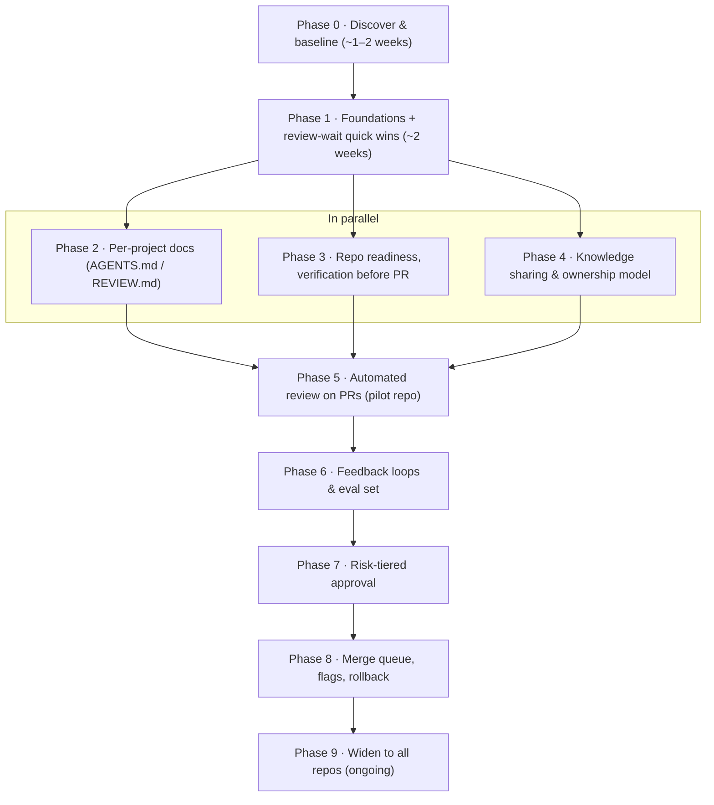

# Step List — Phased Rollout

**Scope:** generic. Team-specific choices live in `teams/<team>.md`; pilot-specific material in `pilot/<repo>/`. \
**How to use:** each phase has steps (checkboxes) and **exit criteria**. A phase is done when its exit criteria are met, not when every box is ticked. Steps marked 🔎 link to prerequisites: team-specific answers in [`02-team-adoption.md`](02-team-adoption.md), or shared investigations and decisions in [`03-process-tracker.md`](03-process-tracker.md). Track team answers in the team profile and shared implementation progress in the process tracker.

**Start small.** Every step is tagged with when it's worth doing:

- 🟢 **Core.** Start here. This is enough for a small team, and it covers review wait, the knowledge silo and basic automated review.
- 🟡 **Later.** Add once the core runs smoothly, usually after month 2–3, or when a metric shows you need it.
- ⚪ **At scale.** Only for high PR volume, many repos or several teams. Skip until there's evidence you need it.

A small team can run the 🟢 steps alone and stop there. See [`00-plan.md` §0.1](00-plan.md#01-start-small-what-to-do-first) for the reasoning.

Phases are ordered by dependency, but some run in parallel. We start on **one pilot repo**, then widen. **Phase 1 includes quick wins** for review wait that need no new tooling.

> Knowledge sharing runs early: it attacks silos directly and also reduces review wait (more people able to review).
> Repository readiness (Phase 3) is done before Phase 5. An automated reviewer on a flaky, unlinted repo with thin tests produces mostly noise.
> Risk-tiered approval stays after the feedback loops: we only lighten human review once data shows the automated layers catch what they should.

---

## Phase 0 — Discover and baseline

**Goal:** know what we have today, and measure where we start.

- [ ] 0.1 🟢 List all repos: language, size, activity, criticality, who knows it best (be honest — this is the silo map) 🔎 [T1](02-team-adoption.md#t--tooling)
- [ ] 0.1b 🟢 Write the team profile ([`teams/README.md`](teams/README.md)): structure, pain points, constraints
- [ ] 0.2 🟡 Tooling inventory per repo: which org it's in, CI, existing branch rules, CODEOWNERS, security and dependency scanning, merge strategy (squash or merge) 🔎 [T1](02-team-adoption.md#t--tooling), [T4](02-team-adoption.md#t--tooling)
- [ ] 0.3 🟡 Release inventory per repo: how it deploys, flags, how to roll back, how long it takes 🔎 [T6](02-team-adoption.md#t--tooling)
- [ ] 0.4 🟢 Run `tools/review-metrics` for the last 3–6 months ([`04-templates.md` §8](04-templates.md#8-metrics-tool)): 🔎 [M1](03-process-tracker.md#m--measurement), [M2](02-team-adoption.md#m--measurement)
  - Time to first human review (median, p95)
  - Time from open to merge
  - Approvals and review comments per PR
  - **Who reviewed** and **who authored** (distribution across people)
  - **Who authored/reviewed per repo** (knowledge spread)
  - Follow-up fixes and reverts
  - Branch updates per PR (merges from base, rebases)
  - CI re-run rate (flaky-test signal)
- [ ] 0.5 🟢 15-minute team conversation: where does waiting hurt, which areas does only one or two people understand?
- [ ] 0.6 🟢 Choose the **pilot repo** 🔎 [P1](02-team-adoption.md#p--process-and-people)
- [ ] 0.7 🟢 Name a process owner and a co-owner from a different part of the team 🔎 [P2](02-team-adoption.md#p--process-and-people)

**Exit criteria:**
- Baseline numbers for the pilot repo exist (rough is fine)
- Silo map exists (repo/area → people who know it)
- Pilot repo agreed

---

## Phase 1 — Foundations + review-wait quick wins

**Goal:** basics later layers depend on, plus immediate relief for review wait. Mostly configuration, plus a few small workflows.

Foundations:
- [ ] 1.1 🟢 PR template in the pilot repo (**Intent / Follow-up to / Manual testing / Risk / Intentional trade-offs / How to revert**). It only asks what CI can't show ([`04-templates.md` §1](04-templates.md#1-pull-request-template))
- [ ] 1.2 🟢 Required status checks on the pilot repo's main branch (lint, types, tests, build)
- [ ] 1.3 🟢 Branch rules: no direct pushes, required checks, 1 approval, **require conversation resolution**, **dismiss stale approvals on new commits**. **Don't** require the branch to be up to date before merging ([`00-plan.md` §4.3](00-plan.md#43-ci-friction-flaky-tests-changelog-conflicts-and-branch-updates)). If a rule can't be enforced by the platform, enforce it with a workflow check instead 🔎 [T2](02-team-adoption.md#t--tooling), [T19](02-team-adoption.md#t--tooling)
- [ ] 1.4 🟢 `CODEOWNERS` on pilot repo: sensitive paths and `.github/workflows/**` → their owners; everything else → whole team 🔎 [R1](02-team-adoption.md#r--risk-tiers-and-approval-policy)
- [ ] 1.5 🟡 Rollback runbook for the pilot repo, tested once 🔎 [T6](02-team-adoption.md#t--tooling)
- [ ] 1.6 🟡 Start `CHANGELOG-review-process.md`
- [ ] 1.6b 🟢 **Changelog fragments** instead of editing `CHANGELOG.md` directly: one file per PR, assembled at release, with a CI check that the fragment exists ([`00-plan.md` §4.3](00-plan.md#43-ci-friction-flaky-tests-changelog-conflicts-and-branch-updates)) 🔎 [T20](02-team-adoption.md#t--tooling)
- [ ] 1.6c 🟢 **Flaky-test policy:** re-run detection opens a `flaky-test` issue, flaky tests are fixed with priority or quarantined (with human approval), and open flaky issues are reviewed in the monthly check 🔎 [T21](03-process-tracker.md#decision-log), [T21-A](02-team-adoption.md#t--tooling)
- [ ] 1.6d 🟢 **Branch update norm:** update only on conflict or stale CI. Merge base into the branch rather than rebasing once human review has started. Agents follow the same rule ([`00-plan.md` §4.3](00-plan.md#43-ci-friction-flaky-tests-changelog-conflicts-and-branch-updates))

Review-wait quick wins:
- [ ] 1.7 🟢 Create a GitHub team for the devs; enable **auto-assignment** (load balance) so reviews spread across everyone, not just the experts 🔎 [T14](03-process-tracker.md#t--tooling), [T14-A](02-team-adoption.md#t--tooling)
- [ ] 1.8 🟢 Agree a **first-response target** (e.g. one working day) and **one daily review slot per person**, at a time that fits their own timezone 🔎 [P8](02-team-adoption.md#p--process-and-people)
- [ ] 1.9 🟢 Soft PR size limit (e.g. ~400 changed lines) with "split or explain" as the escape hatch 🔎 [P3](02-team-adoption.md#p--process-and-people)
- [ ] 1.10 🟢 Draft-PR norm for direction questions ("should we do this?") 🔎 [P7](02-team-adoption.md#p--process-and-people)
- [ ] 1.11 🟡 Scheduled workflow that posts PRs waiting longer than the target to the team channel 🔎 [T15](02-team-adoption.md#t--tooling)
- [ ] 1.12 🟢 *(Optional, time-boxed to 1–2 months)* "Reviews before your own PRs" gate: a new PR's reviewers are only requested once the author has no review requests older than one working day ([`00-plan.md` §4.1](00-plan.md#41-cutting-review-wait)) 🔎 [T18](03-process-tracker.md#t--tooling)

**Exit criteria:**
- Template + rules active on pilot repo for 2 weeks
- Time to first human review measurably lower than baseline
- Review load starting to spread across more people

---

## Phase 2 — Per-project documentation

**Goal:** project knowledge the reviewer and humans need, written down and short. *Parallel with 3 and 4.*

- [ ] 2.1 🟢 Use `AGENTS.md` (vendor-neutral; decided). Add a one-line pointer file only for tools that require their own name
- [ ] 2.2 🟢 Pilot repo `AGENTS.md` — **drafted by someone who is not the main owner, reviewed by the owner**. Writing it is itself a learning exercise
- [ ] 2.3 🟢 Pilot repo `REVIEW.md` — owner corrects a draft extracted from their past review comments ([`00-plan.md` §5.5](00-plan.md#55-getting-knowledge-out-of-peoples-heads)); secondary owner reviews it 🔎 [R6](02-team-adoption.md#r--risk-tiers-and-approval-policy)
- [ ] 2.4 🟢 Mine past human review comments; move recurring mechanical ones into lint rules or CI checks, judgement ones into `REVIEW.md` 🔎 [D9](02-team-adoption.md#d--per-project-documentation)
- [ ] 2.4b 🟡 If several repos share a stack: extract common rules into `shared/<family>-guidelines.md` and vendor a copy into each repo with the sync tool (no cross-org references) 🔎 [D7](02-team-adoption.md#d--per-project-documentation), [D8](03-process-tracker.md#d--per-project-documentation)
- [ ] 2.5 🟡 Add the doc maintenance rules ([`00-plan.md` §5.3](00-plan.md#53-how-these-docs-improve-over-time)) to each repo's contributing guide (vendored with the other shared files)
- [ ] 2.6 🟡 Agree length limits and a quarterly prune slot 🔎 [D2](02-team-adoption.md#d--per-project-documentation), [D3](02-team-adoption.md#d--per-project-documentation)
- [ ] 2.7 🟢 **User documentation rules** in `AGENTS.md`: what counts as user-facing, where docs go, the format (full page or docs note) and who picks them up ([`00-plan.md` §5.6](00-plan.md#56-user-facing-documentation-docs-sync)) 🔎 [D10](02-team-adoption.md#d--per-project-documentation)

**Exit criteria:**
- Both files exist on pilot repo and are reviewed by both owners
- Recurring human comments have a home

---

## Phase 3 — Repository readiness and verification before the PR

**Goal:** the repo is ready for automated review ([`00-plan.md` §3.2](00-plan.md#32-repository-readiness)), and routine mistakes are caught before anyone else looks. *Parallel with 2 and 4. Must be done before Phase 5.*

Verification before the PR:
- [ ] 3.1 🟢 One documented check command that runs format, vet, lint and tests (in cass-operator: `make test`), listed in `AGENTS.md`. No separate pre-commit hooks are needed when this exists; add them only to repos without such a command 🔎 [T7](02-team-adoption.md#t--tooling)
- [ ] 3.3 🟢 Local review step: fresh-context review of the diff + local security review 🔎 [T8](02-team-adoption.md#t--tooling)
- [ ] 3.4 🟢 Automated test results are read from CI, not copied into the PR. The description only covers **manual testing** that CI can't show
- [ ] 3.5 🟡 UI repos: define visual verification 🔎 [T9](02-team-adoption.md#t--tooling)

Repository readiness (one-off, hand-made; scheduled automation only keeps it from slipping back):
- [ ] 3.6 🟢 **Lint:** enable the full linter config and fix the codebase, one linter per PR (pilot: [lint proposal](pilot/cass-operator/lint-proposal.md))
- [ ] 3.7 🟢 **Flaky-test burn-down:** fix or quarantine the known flaky tests, worst first, until the CI re-run rate is below the target. Failures are counted per test from re-runs and the failed jobs' logs 🔎 [T21](03-process-tracker.md#decision-log), [M8](02-team-adoption.md#m--measurement)
- [ ] 3.8 🟢 **CI time:** measure time to green and queue time per workflow and job, then do the cheap wins: cancel superseded runs, Go and image caches, images built once per run, one gate job for path-filtered suites 🔎 [T24](03-process-tracker.md#t--tooling), [T24-A](02-team-adoption.md#t--tooling)
- [ ] 3.9 🟢 **Test gaps in critical areas:** a combined coverage map per area (unit, envtest, end-to-end). Owners pick the gaps that matter, and tests are added at the right level. No coverage percentage gate 🔎 [T25](03-process-tracker.md#t--tooling)
- [ ] 3.10 🟢 **Deterministic checks:** every mechanical rule in `REVIEW.md`, the shared guidelines and the PR template becomes a CI check that also runs in the local check command: changelog fragment, generated files up to date, linked issue, the `needs-human` detector ([`00-plan.md` §3.1](00-plan.md#31-deterministic-checks-are-code-not-review)) 🔎 [T17](03-process-tracker.md#t--tooling)
- [ ] 3.11 🟢 **Docs check:** user-facing changes carry a docs note or docs link, or `skip-docs` with a reason. New CRD fields have descriptions ([`00-plan.md` §5.6](00-plan.md#56-user-facing-documentation-docs-sync)) 🔎 [D10](02-team-adoption.md#d--per-project-documentation)
- [ ] 3.12 🟡 **Changed-lines coverage** shown on each PR as information for the reviewer, not a gate 🔎 [T25](03-process-tracker.md#t--tooling)

**Exit criteria:**
- Authors and agents run the check command before opening a PR (CI failures on first push trend down)
- Local review step used by the whole pilot team
- The full linter config passes on the default branch
- CI re-run rate below the target for two weeks; CI time to green and queue time measured
- Critical areas have a coverage map, and the gaps owners chose are closed
- No mechanical rule is left only in `REVIEW.md` without a check or a "temporary" mark

---

## Phase 4 — Knowledge sharing and ownership model

**Goal:** knowledge spreads beyond the current experts; more people carry real review load. *Parallel with 2 and 3.* See [`00-plan.md` §7.1](00-plan.md#71-ownership-model); the team profile says how it maps onto your team.

- [ ] 4.1 🟢 Assign an **area pair** (primary + secondary owner) for each repo/area; encode in CODEOWNERS 🔎 [K4](02-team-adoption.md#k--knowledge-sharing--anti-silo)
- [ ] 4.2 🟢 Route Low/Medium PRs from the experts to less familiar reviewers; every such review leaves a summary or a question
- [ ] 4.3 🟢 "Explain it back before your first change" norm for anyone entering an unfamiliar area (an AI explainer can help, but the explaining back is done by the person); whatever the developer docs were missing gets written into `docs/developer/` by hand 🔎 [K1](02-team-adoption.md#k--knowledge-sharing--anti-silo), [D6](02-team-adoption.md#d--per-project-documentation)
- [ ] 4.4 🟡 Pair on High-risk changes
- [ ] 4.5 🟡 Define the **graduated ownership** criteria (non-owner → trusted for an area) 🔎 [R3](02-team-adoption.md#r--risk-tiers-and-approval-policy)
- [ ] 4.6 🟡 Fortnightly 20-minute walkthrough in an existing meeting (rotating presenter, everyone takes a turn) 🔎 [K2](02-team-adoption.md#k--knowledge-sharing--anti-silo)
- [ ] 4.7 🟡 Monthly knowledge-spread report from the GitHub API (who authored/reviewed per repo) 🔎 [K3](02-team-adoption.md#k--knowledge-sharing--anti-silo), [T12](03-process-tracker.md#t--tooling)

**Exit criteria (after ~6 weeks):**
- Every pilot area has at least the team's target number of people who authored or reviewed there recently
- Review and authorship distribution clearly more even than baseline

---

## Phase 5 — Automated review on every PR (pilot)

**Goal:** an automated reviewer comments on every pilot PR; findings are high-signal and must be answered. Starts only when the pilot repo meets the Phase 3 exit criteria.

- [ ] 5.1 🟢 Integrate automated review as a GitHub Actions workflow on `pull_request` 🔎 [T3](03-process-tracker.md#t--tooling)
- [ ] 5.1b 🟢 Public repos: decide how fork PRs get reviewed without exposing secrets ([`00-plan.md` §8](00-plan.md#8-open-source-repositories)) 🔎 [T16](02-team-adoption.md#t--tooling)
- [ ] 5.2 🟢 Inline comments tagged **Important / Nit**. **Pre-existing** findings go in the summary only, each with a proposed `tech-debt` issue. Changes that always need a human get a `Needs human:` marker line, not a finding
- [ ] 5.3 🟡 Separate security review pass 🔎 [T4](02-team-adoption.md#t--tooling), [T4-P](03-process-tracker.md#t--tooling)
- [ ] 5.4 🟢 Drop style-only findings (lint's job)
- [ ] 5.5 🟢 Every finding fixed or resolved with a reason; conversation resolution blocks merge (from 1.3)
- [ ] 5.6 🟢 Resolution category captured (`[wrong]` / `[intentional]` / `[not-worth-it]` prefixes, see templates) 🔎 [M3](03-process-tracker.md#m--measurement)
- [ ] 5.7 🟡 Convergence guardrails: round cap 3, diff-only re-review, no repeats, flag the bug class 🔎 [T3](03-process-tracker.md#t--tooling)
- [ ] 5.8 🟢 **Review-state workflow and labels** (`review/bots` → `review/author` → `review/human`, plus the `review/bots-done` commit status). Human reviewers are requested only at `review/human` ([`00-plan.md` §4.2](00-plan.md#42-knowing-when-bots-are-done-review-state-labels)) 🔎 [T14](03-process-tracker.md#t--tooling), [T22](03-process-tracker.md#t--tooling)
- [ ] 5.8b 🟢 **Detector** for `needs-human`: changed or removed test assertions, new `//nolint`, sensitive paths 🔎 [T17](03-process-tracker.md#t--tooling)
- [ ] 5.9 🟢 Two weeks non-blocking, then blocking
- [ ] 5.10 🟢 Weekly `REVIEW.md` tuning during pilot 🔎 [D5](03-process-tracker.md#d--per-project-documentation)

**Exit criteria (~4–6 weeks):**
- `fixed` share above agreed threshold; mean rounds-to-pass below threshold 🔎 [M4](02-team-adoption.md#m--measurement)
- Team says it's net helpful
- No rise in follow-up fixes

---

## Phase 6 — Feedback loops and eval set

**Goal:** the process improves itself, measurably.

- [ ] 6.1 🟡 Metrics dashboard (scheduled Action → markdown report or simple page) 🔎 [M1](03-process-tracker.md#m--measurement), [T11](02-team-adoption.md#t--tooling)
- [ ] 6.2 🟡 Eval set from past follow-up fixes, reverts and bugs (the PR named in `Follow-up to:` is the eval case), each confirmed by someone who knows the code — **non-owners do the digging, an owner confirms** (good way to learn failure modes) 🔎 [M5](02-team-adoption.md#m--measurement)
- [ ] 6.3 ⚪ Known-clean PR set for false alarms
- [ ] 6.4 ⚪ Reviewer config changes scored against both sets before rollout 🔎 [M6](03-process-tracker.md#m--measurement)
- [ ] 6.5 🟢 Incident/bug review asks "which layer should have caught this?"
- [ ] 6.6 🟢 Monthly 30-minute retro **inside the existing team retro**, not a new meeting
- [ ] 6.7 ⚪ Periodic review of existing code 🔎 [T10](03-process-tracker.md#t--tooling)

**Exit criteria:**
- Eval set used on every reviewer change
- Two retros held, decisions logged

---

## Phase 7 — Risk-tiered human approval

**Goal:** human approvals scale with risk. **Start strict, loosen with evidence.**

- [ ] 7.1 🟡 Write tiers for the pilot repo (template in [`04-templates.md`](04-templates.md)) 🔎 [R1](02-team-adoption.md#r--risk-tiers-and-approval-policy), [R8](02-team-adoption.md#r--risk-tiers-and-approval-policy)
- [ ] 7.2 🟢 Always-human paths via CODEOWNERS (sensitive + workflows)
- [ ] 7.3 🟡 Trusted list **per area**, using graduated ownership from 4.5 🔎 [R3](02-team-adoption.md#r--risk-tiers-and-approval-policy)
- [ ] 7.4 ⚪ Tier assignment: start with **path rules + labels** in an Action; classifier later if needed 🔎 [R2](03-process-tracker.md#r--risk-tiers-and-approval-policy), [R2-A](02-team-adoption.md#r--risk-tiers-and-approval-policy)
- [ ] 7.5 🟡 Bot approval never counts as human. Enforce it in the review-state workflow if branch rules can't express it 🔎 [T2](02-team-adoption.md#t--tooling)
- [ ] 7.6 🟢 Agent-written PRs: directing person is accountable and counts as a reviewer
- [ ] 7.7 🟡 Low starts at 1 human; move to 0 only with ≥1 month of supporting data 🔎 [R4](02-team-adoption.md#r--risk-tiers-and-approval-policy), [R7](02-team-adoption.md#r--risk-tiers-and-approval-policy)
- [ ] 7.8 ⚪ Circuit breaker defined 🔎 [R5](02-team-adoption.md#r--risk-tiers-and-approval-policy)
- [ ] 7.9 🟡 **Dependency/CVE update PRs** by a bot or agent following the rules in [`00-plan.md` §4.4](00-plan.md#44-dependency-and-cve-updates): latest patch, re-scan, batch, dependencies only. Low ones need one human for the first month, then auto-merge if follow-up fixes stay at zero 🔎 [T23](03-process-tracker.md#t--tooling)

**Exit criteria:**
- Tiers enforced on pilot; wait time down for Low/Medium; no guardrail regression for ≥1 month

---

## Phase 8 — Merge queue, flags, rollback

**Goal:** mistakes are cheap to catch and undo — this is what makes lighter approval safe.

- [ ] 8.1 ⚪ Merge queue, only when churn makes "passed separately, broke together" a real problem 🔎 [T5](02-team-adoption.md#t--tooling)
- [ ] 8.2 ⚪ Feature flags for new behaviour where the product allows 🔎 [T6](02-team-adoption.md#t--tooling)
- [ ] 8.3 ⚪ Internal use / staging before release 🔎 [P4](02-team-adoption.md#p--process-and-people)
- [ ] 8.4 🟡 Rollback time measured and within target 🔎 [M7](02-team-adoption.md#m--measurement)
- [ ] 8.5 🟡 Who watches after merge: author first, then a rotating "on-duty" dev (everyone in the rotation) 🔎 [P6](02-team-adoption.md#p--process-and-people)

**Exit criteria:**
- Rollback (or fix-forward) within target

---

## Phase 9 — Widen and sustain (ongoing)

- [ ] 9.1 🟡 Short adoption guide from pilot learnings
- [ ] 9.2 🟡 Roll to remaining repos in order of pain (most waiting / most siloed first). Shared pieces are vendored into each repo with the sync tool; each repo adds its own `AGENTS.md`, `REVIEW.md`, CODEOWNERS and goes through Phase 3 readiness before automated review
- [ ] 9.3 🟡 Quarterly: doc prune (repo and shared), risk-tier review, graduated-ownership review, knowledge-spread check
- [ ] 9.4 🟡 Revisit out-of-scope items (tooling/vendor choices) once gaps are clear
